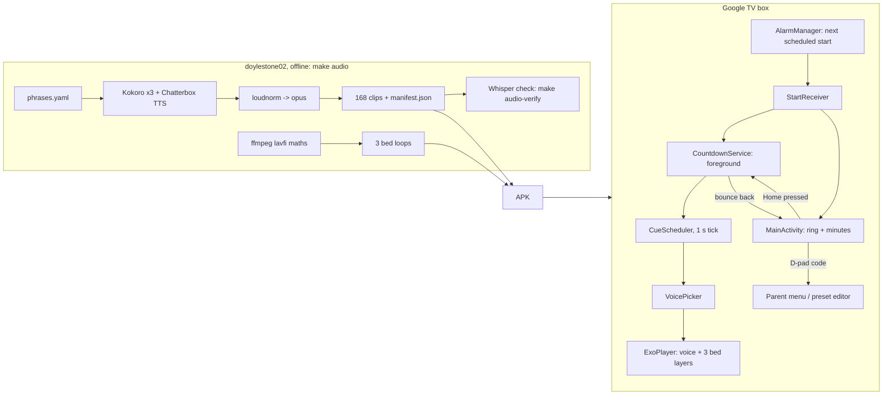

# COUNT-US-DOWN

A calm "leave the house" countdown for Android TV. At 07:45 on weekdays it takes over the living-room TV and counts down to 08:15. The screen shows a big minutes number in a slowly draining ring. Gentle voice cues and an ambient soundscape get more urgent as the deadline gets closer. A parental D-pad code is needed to exit.

> Status: **v1 feature-complete** (commits 1–23). See the design doc for the commit tracker and the log of decisions.

## What it does

- **Starts itself** at a preset's scheduled time (School run: weekdays 07:45), waking the TV out of its ambient screensaver. Presets without a schedule (Football) are started from the parent menu.
- **Shows** whole minutes left inside a slowly draining ring, plus "leave at 08:15". The numeral breathes with a 4 s pulse, and nothing changes faster than once a minute. The background drifts from night blue to dusk, turns amber during the grace period, and dims when late.
- **Speaks** calm cues in four rotating stock voices (3 × Kokoro British + Chatterbox) at T-30, 25, 20, 15, 10, then every minute for the last five, then "time to leave" and "we're late". The wording firms up (gentle → nudge → firm) but the volume never rises.
- **Soundscape:** a synthesised ambient bed that thickens from 1 to 3 layers as the target nears and goes silent when late.
- **Locked:** the remote does nothing visible during a run, and Back is ignored. If Home is pressed, the countdown comes back within ~2 s. The parent's **D-pad code** (default ← ← → ↑ ↓) opens the parent menu: exit, exit and skip today, start a preset, edit presets, change the code.

## How it works

Core timing (`core/`) is plain Kotlin driven by a `Clock`, so every rule is unit-tested without waiting 30 minutes.

## 1. Prerequisites

1. **JDK 17 with a compiler.** `export JAVA_HOME=/usr/lib/jvm/java-17-openjdk-amd64` (a JRE-only `/usr/bin/java` fails with `JAVA_COMPILER` capability errors).
2. **Android SDK** at `~/Android/Sdk` (or set `ANDROID_HOME`) with `platforms;android-36`, `build-tools;36.0.0`, `platform-tools` and `emulator`.
3. `make local-properties` points Gradle at the SDK.
4. `cp local.mk.example local.mk` and fill in the TV mDNS names (see `make wifi-devices`).
5. `make doctor` checks all of the above.

## 2. Usage

| Goal | Command |
| --- | --- |
| Run on the living-room TV | `make run-tv` |
| Run on the front-room TV | `make run-front-tv` |
| Run on the Google TV emulator | `make emulator`, then `make run DEVICE=emulator-5554` |
| Test a short run | `adb shell am start -n uk.howapped.countusdown/.MainActivity --ei duration_minutes 5 --ei grace_minutes 1` |
| Test the scheduled start (debug builds) | `adb shell am broadcast -a uk.howapped.countusdown.DEBUG_ARM -p uk.howapped.countusdown --ei in_seconds 60` |
| See the armed alarm | `make alarms` |
| First-time TV pairing | TV: *Developer options → Wireless debugging → Pair device with pairing code*, then `make pair ADDR=<ip>:<port>` |

Wireless debugging switches itself off whenever the TV restarts. If `make run-tv` says the TV isn't advertising, turn it back on (no re-pairing needed).

If the TV is advertising but `adb` says the connection was refused, check whether **Tailscale is connected on the TV**. While it is, the TV's Wireless debugging screen shows a VPN address (e.g. `10.5.0.2`) instead of its LAN IP and refuses LAN connections. Disconnect Tailscale on the TV and run the command again.

After installing, open the app once (or reinstall): Android doesn't deliver alarms to an app that has never been opened or has been force-stopped.

## 3. Testing

- `make test` runs the JVM unit tests (Robolectric, pinned to SDK 35 because emulating 36 needs Java 21) and the pipeline's pytest suite.
- `make audio-verify` transcribes every voice clip with Whisper and flags any that don't say their script.
- `make test-device` runs the instrumented tests on a connected emulator or TV.
- CI (`.github/workflows/ci.yml`) runs the unit tests and builds the APK on every push and PR.

## 4. Makefile targets

Run `make` to list them all.

| Target | What it does |
| --- | --- |
| `doctor` | Check the JDK, SDK tools, `local.properties`, `local.mk` |
| `local-properties` | Write `local.properties` |
| `build` / `clean` | Build the debug APK / delete build outputs |
| `test` / `test-device` | Unit tests / instrumented tests |
| `emulator` / `emulator-stop` | Start/stop the `Television_1080p` AVD |
| `install` / `launch` / `run` / `stop` / `uninstall` | Device lifecycle (`DEVICE=` to pick one) |
| `logs` / `screenshot` | Follow logcat / save `screenshot.png` |
| `pair` / `wifi-devices` / `tv-connect` | Wireless debugging helpers |
| `run-tv` / `run-front-tv` | Connect to a TV by mDNS name, then build, install and launch |
| `grant` | Allow the app to come to the front by itself (run by `install`) |
| `alarms` | Show the app's next scheduled alarm |
| `audio` / `audio-voices` / `audio-bed` | Regenerate the bundled audio (voices skip existing clips; `FORCE=1` to redo) |
| `audio-verify` / `audio-size` | Whisper-check every clip / show the audio's APK footprint |
| `test-pipeline` | Pipeline pytest only |
| `banner` | Re-render the TV banner PNG |
