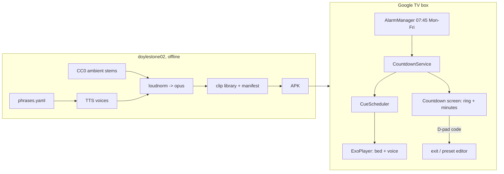

# COUNT-US-DOWN

A calm "leave the house" countdown for Android TV. At 07:45 on weekdays it takes over the living-room TV and counts down to 08:15. The screen shows a big minutes number in a slowly draining ring. Gentle voice cues and an ambient soundscape get more urgent as the deadline gets closer. A parental D-pad code is needed to exit.

> Status: **scaffold (commit #1)**. The app builds, installs and shows its name. The countdown, audio, scheduling and lock come in later features. See the design doc for the commit plan.

## How it works (planned)

## 1. Prerequisites

1. **JDK 17 with a compiler.** `export JAVA_HOME=/usr/lib/jvm/java-17-openjdk-amd64` (a JRE-only `/usr/bin/java` fails with `JAVA_COMPILER` capability errors).
2. **Android SDK** at `~/Android/Sdk` (or set `ANDROID_HOME`) with `platforms;android-36`, `build-tools;36.0.0`, `platform-tools` and `emulator`.
3. `make local-properties` points Gradle at the SDK.
4. `cp local.mk.example local.mk` and fill in the TV mDNS names (see `make wifi-devices`).
5. `make doctor` checks all of the above.

## 2. Usage

| Goal | Command |
| --- | --- |
| Run on the living-room TV | `make run-tv` |
| Run on the front-room TV | `make run-front-tv` |
| Run on the Google TV emulator | `make emulator`, then `make run DEVICE=emulator-5554` |
| First-time TV pairing | TV: *Developer options → Wireless debugging → Pair device with pairing code*, then `make pair ADDR=<ip>:<port>` |

Wireless debugging switches itself off whenever the TV restarts. If `make run-tv` says the TV isn't advertising, turn it back on (no re-pairing needed).

## 3. Testing

- `make test` runs the JVM unit tests (Robolectric, pinned to SDK 35 because emulating 36 needs Java 21).
- `make test-device` runs the instrumented tests on a connected emulator or TV.
- CI (`.github/workflows/ci.yml`) runs the unit tests and builds the APK on every push and PR.

## 4. Makefile targets

Run `make` to list them all.

| Target | What it does |
| --- | --- |
| `doctor` | Check the JDK, SDK tools, `local.properties`, `local.mk` |
| `local-properties` | Write `local.properties` |
| `build` / `clean` | Build the debug APK / delete build outputs |
| `test` / `test-device` | Unit tests / instrumented tests |
| `emulator` / `emulator-stop` | Start/stop the `Television_1080p` AVD |
| `install` / `launch` / `run` / `stop` / `uninstall` | Device lifecycle (`DEVICE=` to pick one) |
| `logs` / `screenshot` | Follow logcat / save `screenshot.png` |
| `pair` / `wifi-devices` / `tv-connect` | Wireless debugging helpers |
| `run-tv` / `run-front-tv` | Connect to a TV by mDNS name, then build, install and launch |
